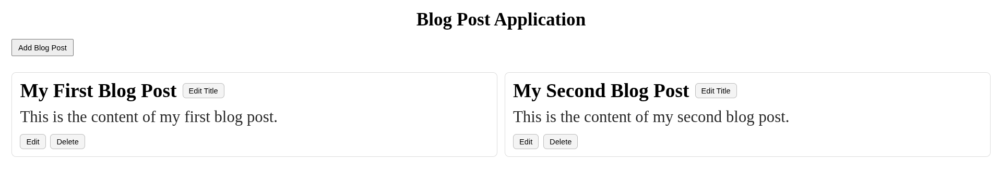

# Blog Post Application

A simple blog post app built with HTML, CSS, and JavaScript. It lets you add, edit, and delete blog posts directly in the browser.

## AI Attribution
*Ideation:* យ៉ន​​ សំណាង - Yorn Samnang

*Proposal proofreading and organization assisted by:* OpenAI. (2026). *GPT-5.3-Codex* [Large language model]. https://chatgpt.com
